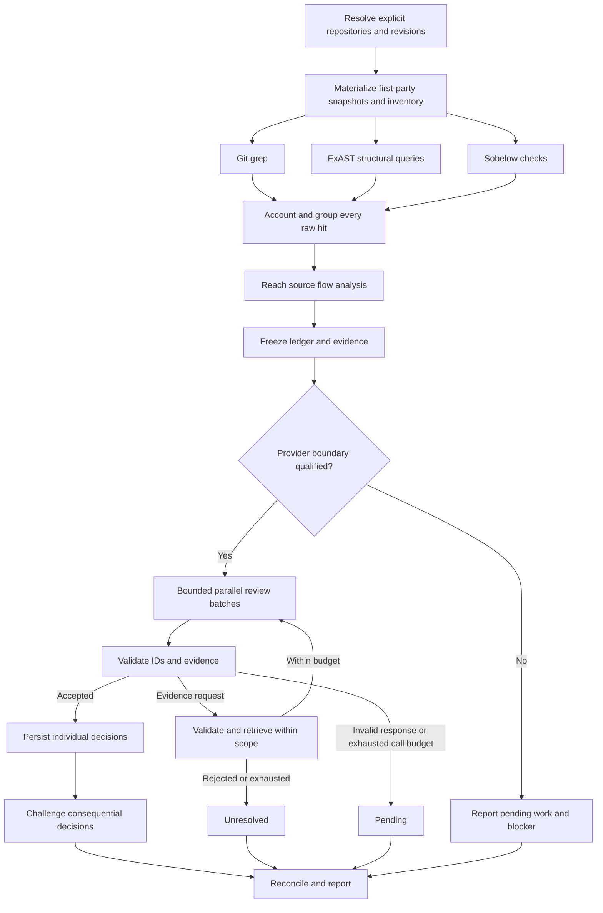

# Execution graph

The workflow is a finite set of concrete stages, not a general workflow engine.

Each repository has a separate discovery worker, native tool artifacts and
candidate ledger. Text and Sobelow jobs run alongside the structural pass.
Reach runs after structural results; no target compilation is requested.

Raw results are retained before grouping. A review group is an exact location
or a small enclosing function range under a single security rule. Identifiers
include the repository root, revision, rule, path and range. Long definitions
fall back to line anchors. Identical calls found by several tools retain all
raw identifiers. Ordinary `Enum`, `inspect`, `decode` and `query` terms are
context-only under the declared policy; they are not independently queued.
The rule catalogue and prompts are copied into the run and hashed.

Review is performed only over the deterministic queue. The first pass and the
challenge pass use bounded parallel batches. Evidence requests only return
scoped source excerpts or literal-symbol occurrences. A second invocation sees
the prior result and additional evidence; ASM owns its one-shot provider session.
No custom agent runtime, provider SDK, graph builder, or parser is implemented.

A missing scan result, unsupported syntax or failed review remains visible.
There is no policy that silently turns missing evidence into safety. See the
results guide for interruption and budget behavior.
