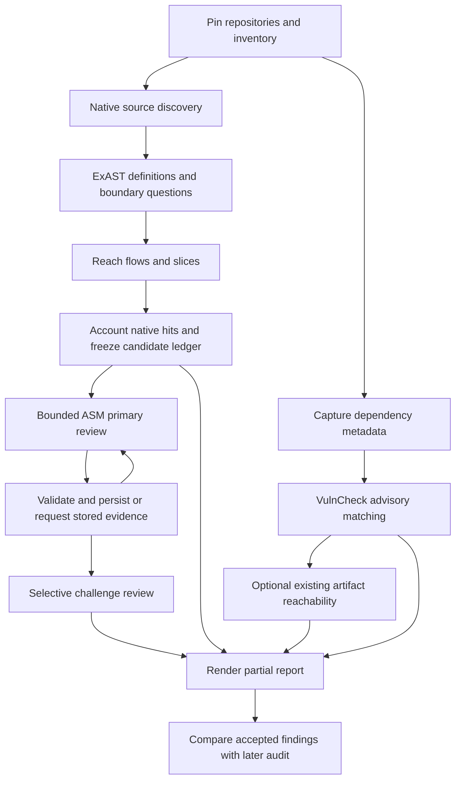

# Execution graph

Discovery is deterministic and can finish independently of review. Git and
Sobelow run alongside structural extraction. Reach builds a single project model
and performs native taint queries grouped by source family. Flow-derived hits
enter the ledger before grouping. Public sensitive boundaries and owner-supplied
questions use the same candidate pipeline. Rules, source, analysis facts and
prompt hashes are frozen for recovery. Dependency scans are serial within a run
to reuse native feed caching; source coverage does not depend on their success.

Source hits are queued, context-only, or explicitly excluded. Related native
rules can share an investigation; original hits remain available. A review
receives recorded source, relevant flows, slices and native messages. The runner
chooses work, validates results and retrieves only bounded evidence. Additional
rounds persist before calls. Consequential conclusions receive a challenge.
Provider errors pause new launches. The cumulative budget is shared by every
repository in a run. No model participates in inventory, matching, accounting,
report regeneration or comparison. Separate processes do not share a budget.
