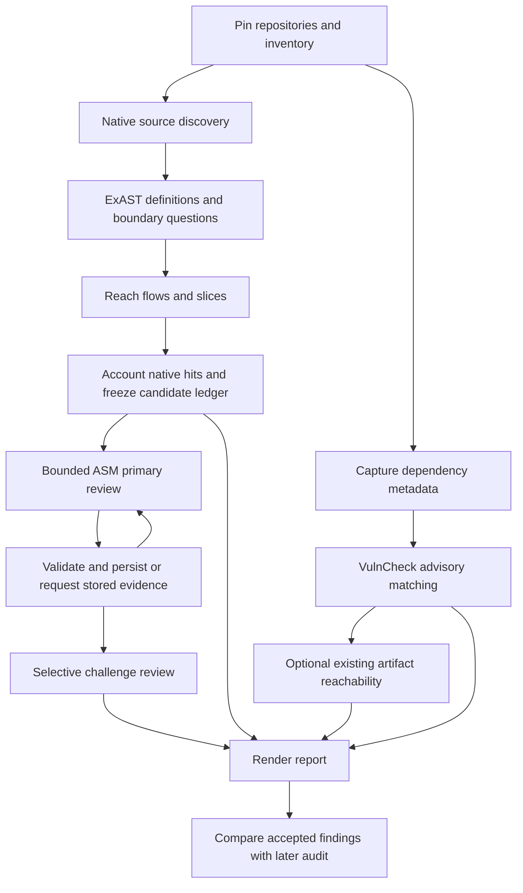

# Workflow

## 1. Pin and capture inputs

BeamAudit resolves explicit repository roots and Git revisions, inventories
tracked files, and captures source and applicable dependency metadata. Rules,
prompts, source and analysis digests establish the inputs for later recovery.
No target build or model call is needed to capture or analyze these inputs.

## 2. Discover source candidates

Source discovery runs in a separate Elixir worker for each repository, with
repository concurrency capped at `min(jobs, 2)`. Git text search and Sobelow run
alongside ExAST structural extraction. Sobelow scans captured Mix application
roots with `lib/` source (or the snapshot root when no Mix manifest is present).
It uses `--no-config`, `--no-router`, strict SARIF output and `--ignore Vuln`;
dependency advisories are handled separately. Unsupported layouts and failures
remain visible.

Reach builds a single project model and performs native taint queries grouped
by source family. Flow-derived hits enter the ledger before grouping. Public
sensitive boundaries and explicit audit questions use the same candidate
pipeline.

## 3. Assess resolved dependencies

The `full` profile runs source and dependency analysis; `source` skips dependency
assessment; `dependencies` skips source analyzers and has no review queue.
Dependency scans are serial within a run to reuse VulnCheck's native feed cache.
Source coverage does not depend on their success. Existing compiled artifacts
are captured only on request. A native reachability classification does not
remove an advisory match.

## 4. Review and challenge

Source hits are queued, context-only, or explicitly excluded. Related native
rules can share an investigation; original hits remain available. A review
receives recorded source, relevant flows, slices and native messages. The runner
chooses work, validates results and retrieves only bounded evidence. Additional
rounds persist before calls. Consequential conclusions receive a challenge.
Provider errors pause new launches. The cumulative budget is shared by every
repository in a run; separate runs do not share a budget. Discovery-only skips
this entire stage. See [Review and evidence](review-and-evidence.md) for the
review order, validation and call limits.

## 5. Report and compare

Discovery can finish independently of review and render a partial report.
Subsequent review updates the saved decisions and report. No model participates
in inventory, matching, accounting, report regeneration or comparison. Compare
findings with a new audit after changes, without assuming that an unobserved
finding is fixed. See [Results and recovery](results-and-recovery.md).
